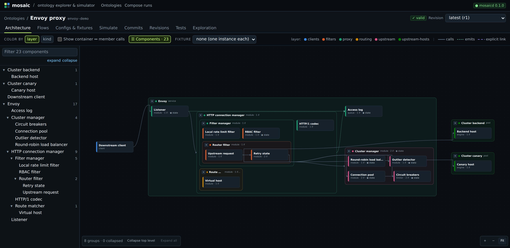
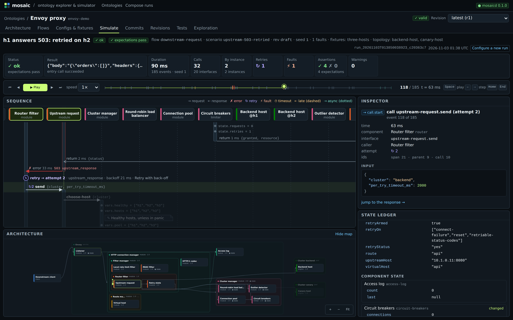

# Mosaic

Mosaic models software systems as versioned **ontologies** and simulates user and system actions
through them, down to the fake data passed between the smallest modeled components, with retries,
timeouts and injected faults.

It is built in three pillars:

1. **Understand**: generate an ontology from code repos, visualize the system, and simulate flows
   through it.
2. **Draft**: describe a change as a draft ontology, then show and simulate it the same way.
3. **Build and compare**: propose several plans of fae workflows and task DAGs that would reach the
   draft, narrow them by simulation, implement the survivors in parallel on fae, and keep the one
   that wins on the user's metrics.

This repository is the foundation for pillar 1: a Dolt-backed ontology store with revisions, a
deterministic simulator, an agent CLI with skills, and a web UI. [docs/DESIGN.md](docs/DESIGN.md)
is the contract: the meta-model, the behavior language, simulation semantics, the API and the CLI.

## Quick start

### Install

Requires Go 1.27 or newer and Node 20.9 or newer. Install those yourself; the install script
checks for them and stops if either is missing or too old. Mosaic also needs Dolt 2.x, which the
script installs when it's missing.

```sh
scripts/install.sh               # checks Go and Node, installs Dolt if needed, builds bin/, installs the web UI's dependencies
scripts/install.sh --go-install  # the same, and also installs mosaic and mosaicd into Go's bin folder
```

Without the script, you need Dolt on your `PATH`; see the
[Dolt installation guide](https://docs.dolthub.com/introduction/installation).

**Dolt.** The script uses Homebrew on macOS when it's available. Otherwise it downloads the latest
release into `~/.local/bin`, without sudo; pass `--prefix DIR` to choose another folder. Run
`scripts/install.sh --help` for every option.

**Running `mosaic` and `mosaicd` from anywhere.** `--go-install` puts both binaries in Go's bin
folder: `$GOBIN` if set, else `$(go env GOPATH)/bin`, usually `~/go/bin`. Make sure that folder is
on your `PATH`, for example in `~/.zshrc` or `~/.bashrc`:

```sh
export PATH="$(go env GOPATH)/bin:$PATH"
```

To do it without the script, from a clone:

```sh
go install ./cmd/mosaic ./cmd/mosaicd
```

Or install straight from GitHub:

```sh
go install github.com/xleelz/mosaic/cmd/mosaic@latest github.com/xleelz/mosaic/cmd/mosaicd@latest
```

### Model your own repo

The preferred way to model a repository is with Claude, using the skills in
[.claude/skills](.claude/skills). Claude Code, or any Claude agent that loads them, picks them up
when started in this repository:

- `mosaic-generate` drives the whole multi-agent pipeline for a large repository: inventory,
  skeleton and contracts, fixtures, fan-out to area agents, reconciliation, a test oracle from the
  repository's own tests, and blind judging. Its runbook is [docs/PIPELINE.md](docs/PIPELINE.md).
- `mosaic-ontology` and `mosaic-simulation` cover a small system, or hand edits to a model:
  components, interfaces, behaviors, scenarios and simulation runs.

With `mosaicd` running, start `claude` in a mosaic checkout and ask, for example, "Use the
mosaic-generate skill to build an ontology of ~/src/<repo>", or, for a small project, "model this
service with mosaic". Writing the YAML by hand and applying it with `-f`, as in Run below, is the
manual path, for small models and edits.

### Run with `scripts/serve.sh` (recommended)

From a checkout, after `scripts/install.sh`, one command builds and runs `mosaicd` and the web UI
together, and keeps them up to date:

```sh
scripts/serve.sh                 # mosaicd on 127.0.0.1:7878, the UI on http://127.0.0.1:3000
scripts/serve.sh --dev           # the UI with pnpm dev instead of a production build
scripts/serve.sh --data-dir ~/.mosaic --addr 127.0.0.1:7878 --web-port 3000 -- --token "$MOSAIC_TOKEN"
```

Logs from both go to stdout, prefixed `[mosaicd]` and `[web]`; Ctrl-C stops both. Arguments after
`--` go to `mosaicd`.

**Updating.** The chip next to the `mosaicd` badge in the UI's top bar shows the commit you are
running, and "N new commits" when the checkout's upstream has moved. Click it, then **Update and
restart**: `mosaicd` fast-forwards the checkout (`git merge --ff-only`) and exits, and `serve.sh`
rebuilds the binaries and the UI and restarts both; the page reloads when they are back. From a
terminal, `mosaic version` shows the same status and `mosaic update --yes` does the same update.
Updates are refused, with the reason, when the checkout has local changes to tracked files, has
commits that aren't upstream, or isn't on a branch with an upstream; `mosaicd --no-self-update`
turns them off.

### Run

The commands below assume `mosaic` and `mosaicd` are on your `PATH`: install them with
`scripts/install.sh --go-install` or `go install`, and add Go's bin folder to `PATH` as shown above.

```sh
mosaicd --data-dir ~/.mosaic &          # supervises its own dolt sql-server, on 127.0.0.1:7878

mosaic ontology create envoy-demo --name "Envoy proxy"
mosaic apply envoy-demo -f examples/envoy/ontology.yaml -m "Model Envoy 1.36.2"
mosaic test envoy-demo                  # runs all 22 scenarios' expectations
mosaic sim run envoy-demo --scenario upstream-503-retried --format summary
# h1 hangs past the 2 s per-try timeout and the retry circuit breaker is full: 504, flags UO,UT
mosaic sim run envoy-demo --flow downstream-request --fixture three-hosts \
    --fault backend-host.handle:timeout --state circuit-breakers.retries=3 --format summary
```

Then start the web UI against the running `mosaicd`, and open http://localhost:3000:

```sh
cd web && pnpm dev
```

The web UI lives in [web/](web/README.md). Set `MOSAIC_SERVER` if `mosaicd` listens somewhere else,
or set `NEXT_PUBLIC_MOSAIC_FIXTURES=1` to use fixtures generated from the engine, with no daemon.

The Architecture tab shows the Envoy model's components, nested by their parent, and the calls
between them:



A simulation run, paused mid-way through `upstream-503-retried`: h1's 503 comes back, and the
router's retry policy sends attempt 2 after a back-off. The sequence diagram, the inspector, the
state ledger and the architecture map all follow the playback cursor:



## The example

[examples/envoy](examples/envoy/ontology.yaml) models one downstream HTTP request through the
[Envoy](https://github.com/envoyproxy/envoy) proxy at v1.36.2: the listener's filter chain match,
the HTTP connection manager and its header size limit, the local rate limit and RBAC filters, the
route table (virtual host, then route, with a direct response and a redirect), and the router
filter's timeouts and retry policy, over a round-robin cluster with circuit breakers and outlier
detection. Each claim cites the Envoy source line it comes from, and every default the
configuration leaves out (the 15 s route timeout, `num_retries` 1, circuit breakers at 1024, 1024,
1024 and 3) is a config entity with its citation.

It has 23 components, 23 interfaces, 20 configs, one fixture (`three-hosts`, the upstream hosts
`h1` to `h3` and `c1` as instances), one flow (`downstream-request`) and 22 scenarios whose
expectations pass. Each response carries Envoy's codes, `x-envoy-*` headers and access-log response
flags, and each outcome is driven by a different mechanism:

- input data: a public source address with no filter chain, oversized headers, an unknown host
  or path (404 `NR`), `/healthz` and `/account/` (a direct response and a redirect), the
  `x-canary` header route, an RBAC-denied path;
- component state: an empty token bucket (429 `RL`), pending requests at the circuit-breaker
  maximum (503 `UO` with `x-envoy-overloaded`), the retry circuit breaker full, an ejected host
  skipped, a host's fifth consecutive 5xx ejecting it;
- choice points: the load balancer's random round-robin start;
- injected faults: an upstream 503 retried on the next host, a 500 passed through, a per-try
  timeout retried, the canary hanging past the route timeout (504 `UT`), a reset retried, every
  host answering 503 (`URX`) or refusing connections (`URX,UF`).

## Development

```sh
go test ./...                                   # needs the dolt binary for store/api tests
go run ./internal/devtools/fixtures -out web/fixtures   # refresh UI fixtures after engine changes
```

Agent skills for operating mosaic are in [.claude/skills](.claude/skills).
